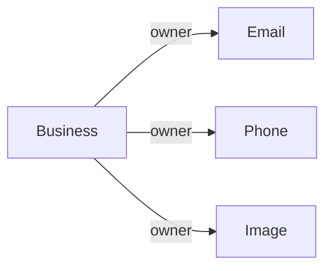

# Business

Representa un negocio que publica productos y puede ser propietario de datos de contacto e imágenes relacionadas.

## Campos

| Campo | Tipo | Requerido | Reglas |
| --- | --- | --- | --- |
| `name` | `String` | Sí | `trim`, único |
| `description` | `String` | No | `trim` |
| `instagramUrl` | `String` | No | `trim` |
| `facebookUrl` | `String` | No | `trim` |
| `whatsappUrl` | `String` | No | `trim` |
| `xUrl` | `String` | No | `trim` |

## Relaciones

Business es destino de referencias polimórficas desde `Email`, `Phone` e `Image` (`ownerType: "Business"`).

No se declaran eliminaciones en cascada ni relaciones inversas en el esquema.

