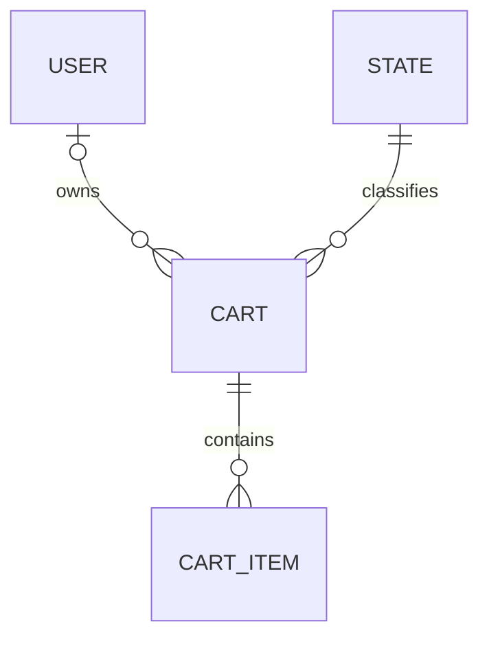

# Cart

Representa un carrito de compra.

## Campos

| Campo | Tipo | Requerido | Reglas |
| --- | --- | --- | --- |
| `name` | `String` | No | Valor por defecto: `"Cart"` |
| `user` | `ObjectId` | No | Referencia a `User` |
| `state` | `ObjectId` | Sí | Referencia a `State` |

## Relaciones

Un carrito puede pertenecer a un usuario y se compone de uno o más `CartItem`. El esquema no declara la relación inversa ni cascadas.

