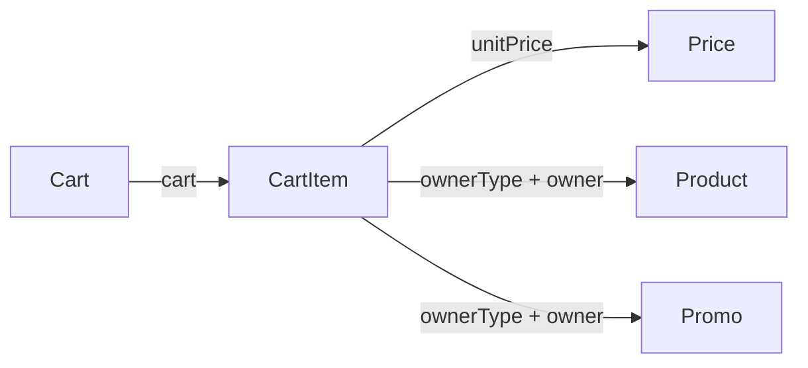

# CartItem

Representa una línea de un carrito y el precio unitario aplicado.

## Campos

| Campo | Tipo | Requerido | Reglas |
| --- | --- | --- | --- |
| `cart` | `ObjectId` | Sí | Referencia a `Cart` |
| `ownerType` | `String` | Sí | Enum: `Product`, `Promo` |
| `owner` | `ObjectId` | Sí | `refPath: ownerType`, indexado |
| `unitPrice` | `ObjectId` | Sí | Referencia a `Price` |
| `quantity` | `Number` | No | Default `1`, entero, mínimo `1` |

`ownerType` determina el modelo que se resuelve para `owner`: `Product` o `Promo`. La cantidad no puede ser fraccionaria ni menor que uno. No hay una regla de unicidad que impida repetir el mismo producto o promoción en el carrito.

