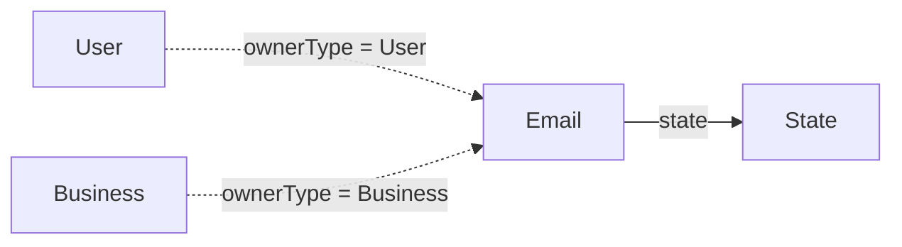

# Email

Dirección de correo asociada a un usuario o negocio.

## Campos

| Campo | Tipo | Requerido | Reglas |
| --- | --- | --- | --- |
| `email` | `String` | Sí | Único, `trim`, `lowercase`, formato de correo |
| `ownerType` | `String` | Sí | Enum: `Business`, `User` |
| `owner` | `ObjectId` | Sí | `refPath: ownerType`, indexado |
| `state` | `ObjectId` | Sí | Referencia a `State` |

La unicidad de `email` es global en la colección, independientemente del propietario.

