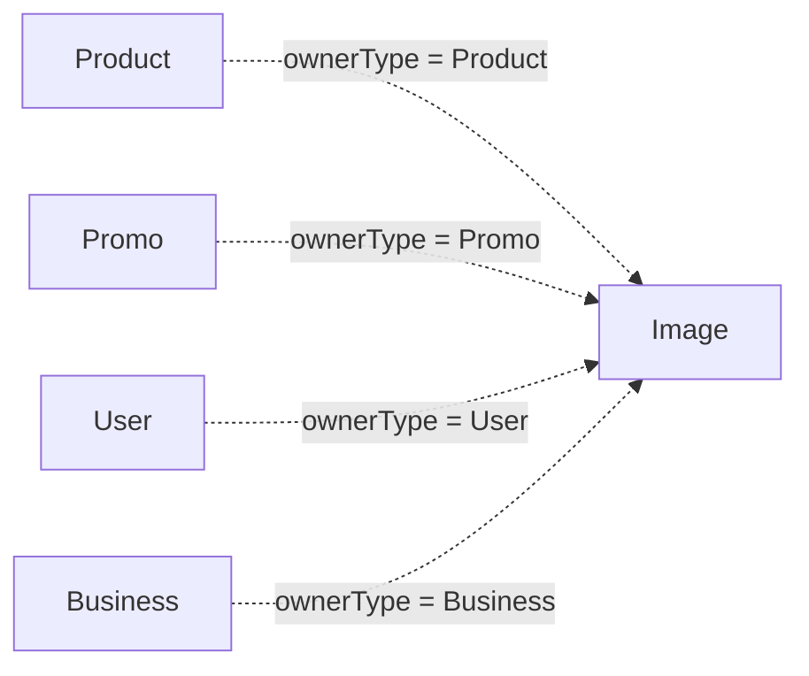

# Image

Representa una imagen asociada a una entidad del sistema.

## Campos

| Campo | Tipo | Requerido | Reglas |
| --- | --- | --- | --- |
| `url` | `String` | Sí | `trim`, URL `http` o `https` |
| `name` | `String` | Sí | `trim` |
| `isMain` | `Boolean` | No | Default `false` |
| `ownerType` | `String` | Sí | Enum: `Product`, `Promo`, `User`, `Business` |
| `owner` | `ObjectId` | Sí | `refPath: ownerType`, indexado |

La combinación `ownerType` + `owner` resuelve el propietario polimórfico. El esquema no limita a una sola imagen principal por propietario.

