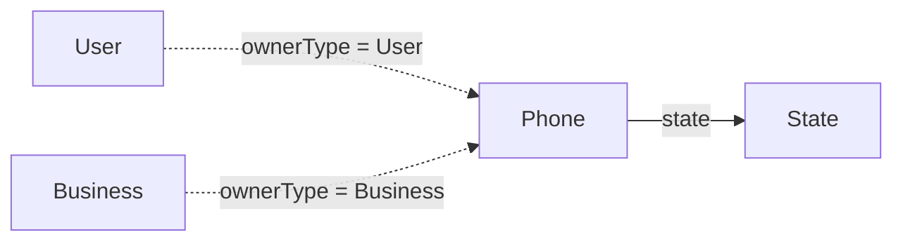

# Phone

Número telefónico asociado a un usuario o negocio.

## Campos

| Campo | Tipo | Requerido | Reglas |
| --- | --- | --- | --- |
| `countryCode` | `String` | Sí | `trim` |
| `phone` | `String` | Sí | `trim` |
| `ownerType` | `String` | Sí | Enum: `Business`, `User` |
| `owner` | `ObjectId` | Sí | `refPath: ownerType`, indexado |
| `state` | `ObjectId` | Sí | Referencia a `State` |

El esquema no declara unicidad para el número completo ni una validación de formato internacional.

