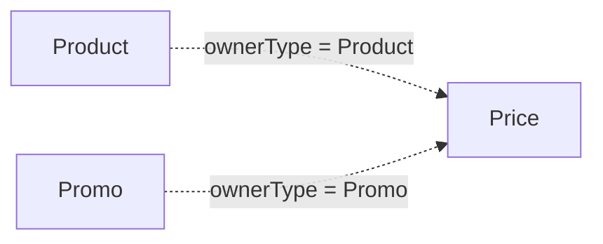

# Price

Representa un precio asociado a un producto o promoción.

## Campos

| Campo | Tipo | Requerido | Reglas |
| --- | --- | --- | --- |
| `amount` | `Decimal128` | Sí | Mínimo `0.01`, máximo `1000000` |
| `isCurrent` | `Boolean` | No | Default `false` |
| `ownerType` | `String` | Sí | Enum: `Product`, `Promo` |
| `owner` | `ObjectId` | Sí | `refPath: ownerType`, indexado |

`ownerType` controla si `owner` apunta a `Product` o `Promo`. El esquema no garantiza que exista un único precio actual por propietario.

