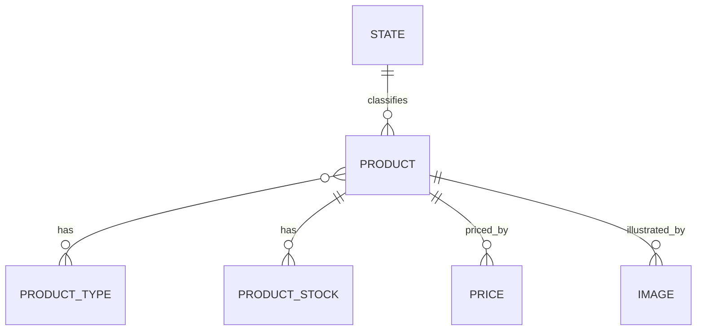

# Product

Representa un producto vendible.

## Campos

| Campo | Tipo | Requerido | Reglas |
| --- | --- | --- | --- |
| `name` | `String` | Sí | `trim`, máximo 150 caracteres |
| `description` | `String` | No | `trim`, máximo 500 caracteres |
| `state` | `ObjectId` | Sí | Referencia a `State` |
| `type` | `ObjectId[]` | No | Elementos requeridos, referencias a `ProductType` |

`type` es un array de referencias; cada elemento debe ser un `ObjectId` válido. El esquema no exige que el array tenga al menos un elemento.

