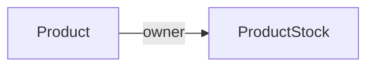

# ProductStock

Representa la existencia disponible de un producto.

## Campos

| Campo | Tipo | Requerido | Reglas |
| --- | --- | --- | --- |
| `stock` | `Number` | Sí | Único, mínimo `0` |
| `owner` | `ObjectId` | Sí | Referencia a `Product` |

`stock` está marcado como único en el esquema actual: MongoDB no permitirá que dos documentos tengan el mismo valor de stock. Esto documenta el comportamiento implementado, aunque normalmente la unicidad esperada estaría en `owner`.

