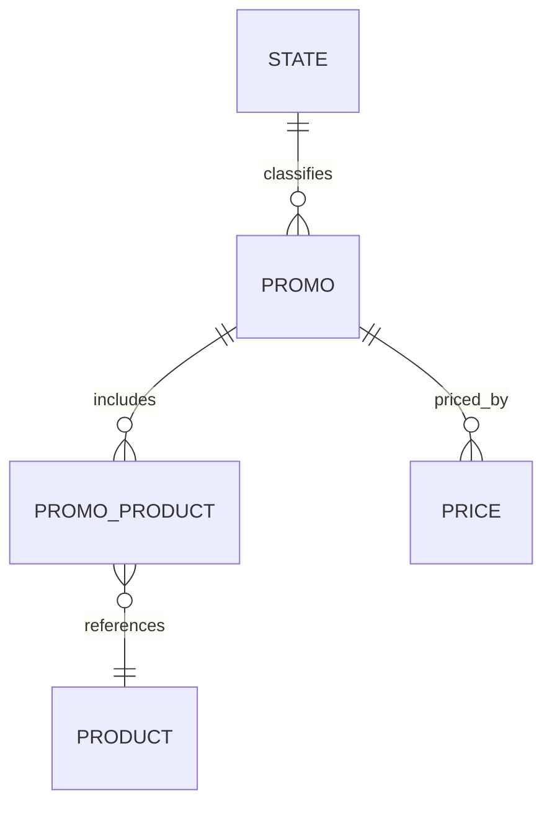

# Promo

Representa una promoción aplicable a productos.

## Campos

| Campo | Tipo | Requerido | Reglas |
| --- | --- | --- | --- |
| `name` | `String` | Sí | `trim`, máximo 150 caracteres |
| `description` | `String` | No | `trim`, máximo 500 caracteres |
| `date` | `Date` | No | Indexado |
| `state` | `ObjectId` | Sí | Referencia a `State` |
| `productMaxCount` | `Number` | No | Default `1`; sin mínimo ni validación de entero en el esquema actual |

Los productos de la promoción se relacionan mediante `PromoProduct`. El código actual utiliza `mongoose.Schema.Types.ObjectId`, pero no importa `mongoose`; por tanto, el modelo requiere corregir esa importación antes de poder cargarse.

