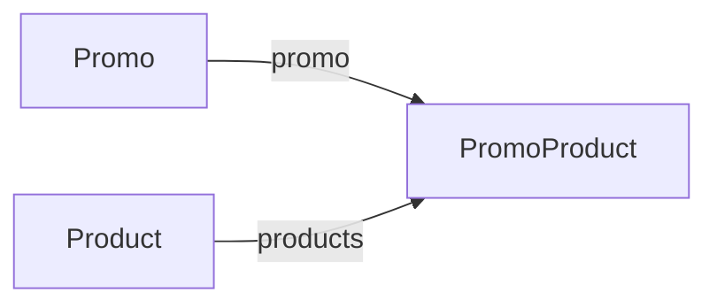

# PromoProduct

Entidad de unión entre una promoción y un producto.

## Campos

| Campo | Tipo | Requerido | Reglas |
| --- | --- | --- | --- |
| `promo` | `ObjectId` | Sí | Referencia a `Promo` |
| `products` | `ObjectId` | Sí | Referencia a `Product` |

Aunque el nombre `products` es plural, el campo actual contiene una sola referencia, no un array. No se declaran índices únicos ni validación para evitar duplicados de la pareja `promo` + `products`.

