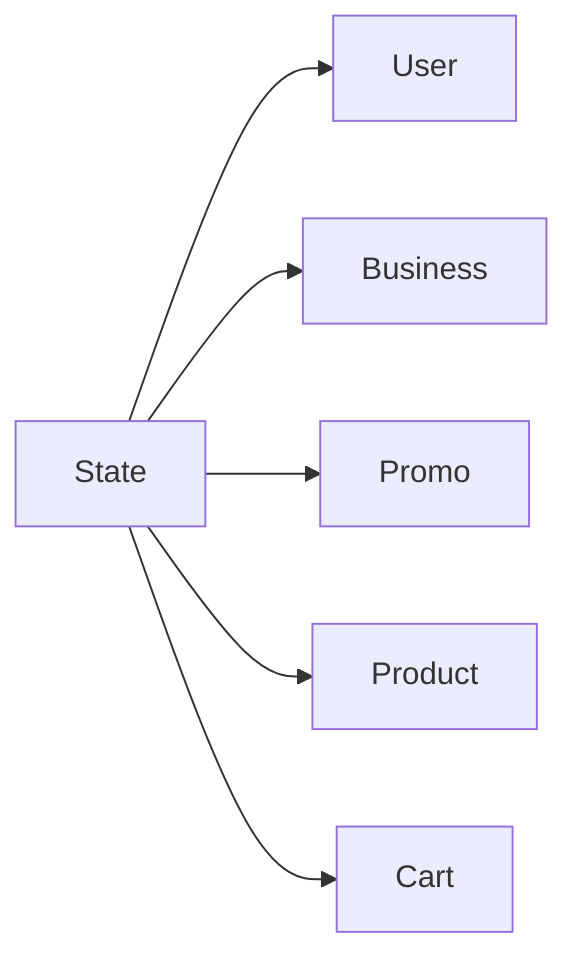

# State

Catálogo de estados reutilizado por entidades del sistema.

## Campos

| Campo | Tipo | Requerido | Reglas |
| --- | --- | --- | --- |
| `name` | `String` | Sí | `trim`, único |
| `description` | `String` | No | `trim` |
| `color` | `String` | No | `trim` |
| `type` | `String` | Sí | Enum: `users`, `business`, `promos`, `products`, `cart` |

`type` indica el catálogo al que pertenece el estado. El esquema no fuerza que un documento consumidor use un estado cuyo `type` coincida con su entidad.

